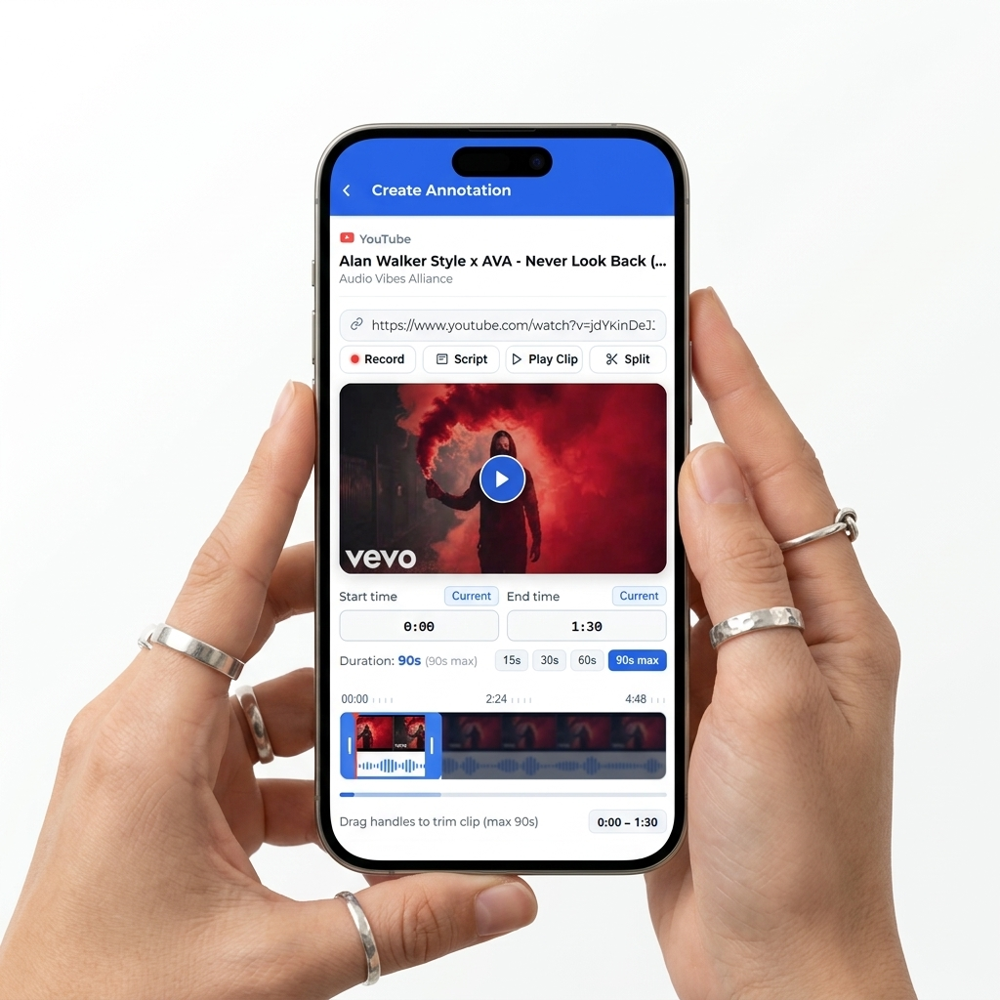
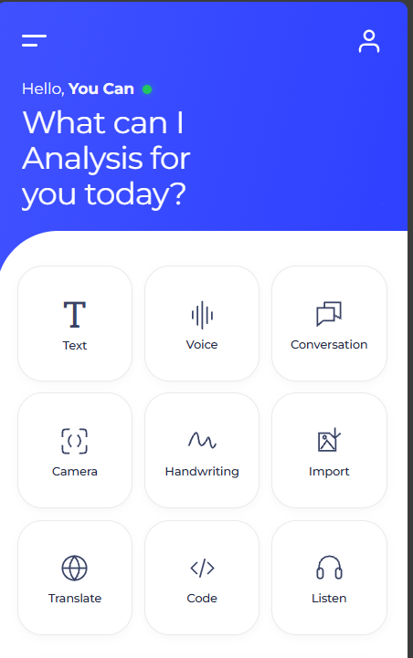
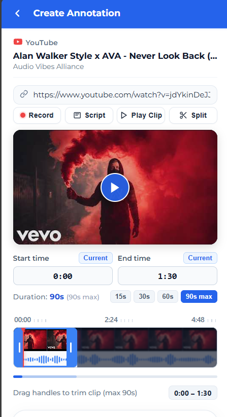

<div align="center">
  
  
  <br />
  <br />

  # Annotated 
  
  **Empowering Digital Research & Collaborative Annotations**
  
  [](https://opensource.org/licenses/ISC)
  [](https://nextjs.org/)
  [](https://developer.chrome.com/)
  [](https://supabase.com/)

  [Features](#-key-features) • [Use Cases](#-use-cases) • [Installation](#-installation--setup) • [Architecture](#-architecture)
</div>

<br />

<div align="center">
  
</div>

<br />

## 🎯 What is Annotated?

**Annotated** is a cutting-edge, AI-powered platform designed to seamlessly integrate web browsing, video analysis, and community-driven knowledge sharing. 

By combining a **powerful Chrome Extension** (Manifest V3) with a **robust Next.js web application**, Annotated allows users to capture, summarize, and extract insights directly from the web, and share them on a centralized community feed where knowledge enthusiasts connect.

---

## 🎨 Interactive Interface

Experience a smooth, MacOS-inspired user interface designed for focus and productivity. 

<div align="center">
  
</div>

---

## 🚀 Key Features

* **🧠 AI-Powered Summarization**  
  Utilize advanced generative AI models (integrated via Google GenAI) to summarize long-form articles and web pages instantly.
* **🎥 Video Annotation & Clipping**  
  Capture, annotate, and share specific video segments from supported platforms without leaving the browser.
* **💬 Contextual Knowledge Assistant**  
  Highlight text on any webpage to ask questions, request explanations, or generate insights.
* **🌍 Community Feed**  
  A centralized hub where users can discover trending research tags, view public annotations, like, bookmark, and comment on community posts.
* **🔒 Secure Authentication**  
  End-to-end user authentication and session management ensuring secure access to personal workspaces.

---

## 💡 Use Cases

### 1. **Academic Researchers & Students**
Highlight complex academic journals, instantly generate summaries, and compile notes into a centralized dashboard. Share findings directly to the community feed to collaborate with peers.

### 2. **Content Creators & Journalists**
Extract exact timestamps and video clips from YouTube for referencing. Compile rapid research from multiple sources without losing track of the original context.

### 3. **Developers & Tech Enthusiasts**
Seamlessly analyze code snippets on GitHub or documentation pages. Ask the AI context-aware questions about the highlighted code without switching tabs.

<div align="center">
  
</div>

---

## ⚙️ Architecture & Tech Stack

Annotated follows a decoupled, highly-scalable architecture:

<details>
<summary><b>Frontend Application</b></summary>

- **Framework**: Next.js 16 (App Router), React 19
- **Styling**: Tailwind CSS 4
- **Animations**: Framer Motion & GSAP for highly interactive UI components.
</details>

<details>
<summary><b>Browser Extension</b></summary>

- **Core**: Chrome Extension Manifest V3
- **Logic**: Background service workers and content scripts isolated from the main page DOM.
</details>

<details>
<summary><b>Backend & Infrastructure</b></summary>

- **API**: Node.js/Express.js RESTful architecture.
- **Database**: PostgreSQL / Supabase integration for reliable data storage.
- **AI Integration**: `@google/genai` for NLP and text analysis capabilities.
</details>

---

## 🛠️ Installation & Setup

### Prerequisites

- [Node.js](https://nodejs.org/) (v18.0.0 or higher recommended)
- [npm](https://npmjs.com/) (v9.0.0 or higher)
- A Chromium-based browser (Google Chrome, Microsoft Edge, Brave).

### 1. Clone & Install
```bash
git clone https://github.com/AbdullahBalfaqih/Annotated.git
cd Annotated
npm install
```

### 2. Environment Configuration
Create a `.env` file in the root directory:
```env
# API Configuration
PORT=5000

# Database Configuration
DATABASE_URL=your_database_connection_string

# AI Services Configuration
GEMINI_API_KEY=your_gemini_api_key

# Authentication
JWT_SECRET=your_secure_jwt_secret
```

### 3. Run the Development Environment

Start the Backend API Server:
```bash
npm run server
```

Start the Frontend Web Application:
```bash
npm run dev
```

---

## 📦 Building for Production

Annotated utilizes a custom build script that compiles the Next.js application, optimizes assets, and bundles the Chrome extension into a single output directory.

```bash
npm run build
```

**Loading the Extension in Chrome:**
1. Navigate to `chrome://extensions/`
2. Enable **"Developer mode"** in the top right corner.
3. Click **"Load unpacked"** and select the generated `out/` or `dist/` directory.

---

## 📄 License

This project is licensed under the ISC License.

<div align="center">
  <sub>Built with passion for knowledge sharing.</sub>
</div>
